# CloudCV Launchpad
Proyecto de Cloud Computing, realizado por Juliana Hernandez y Macarena Piñeiro.

### ¿Qué es?  
Es un CV publicado como página web, con un contador que muestra cuántas veces se visitó. Realizado con Azure y OpenTofu (la versión libre de Terraform: usa el mismo lenguaje).

### ¿Cómo funciona?   
1. La página del CV está guardada en una cuenta de Storage de Azure, que la publica como sitio web con HTTPS.
2. Cuando alguien entra, el JS de la página llama a una Azure Function (un pedazo de código que solo corre cuando lo llaman).
3. La función suma 1 al contador, que está guardado en una tabla y devuelve el número para mostrarlo en la página.
4. Cada vez que subimos cambios a GitHub, GitHub Actions revisa el código y lo despliega en Azure. Para entrar a Azure no usa contraseñas guardadas en el repo, sino un permiso que Azure le da a nuestro repo.

### ¿Por qué lo hicimos así?
* La página está en Storage y no en Static Web Apps, ya que nuestra suscripción de estudiantes solo deja crear cosas en algunas regiones, y Static Web App no está en ninguna de ellas.
* Usamos Table Storage para el contador, debido a que solo guardamos un número, así que no hace falta una base de datos más grande.
La página es pública: es un CV, la idea es que cualquiera lo pueda ver.

### Reglas que seguimos
**Región:** `canadacentral`. Es una de las que permite la suscripción y es más barata que Brasil.
**Nombres:** todo lleva `cloudcv` en el nombre. Las cuentas de Storage van sin guiones porque Azure no los acepta (por ejemplo, `cloudcvweb…`). Los demás recursos empiezan con una abreviatura del tipo y usan guiones (por ejemplo, `rg-cloudcv-dev` o `func-cloudcv-…`).
**Etiquetas en todos los recursos:** `project`, `team`, `env` y `owner`, para saber de quién es cada cosa y cuánto cuesta.
**Cambios:** todo entra por Pull Request y lo revisa la otra antes de unirlo a `main`.

### ¿Qué hay en cada carpeta?
* `app/site/`: la página del CV
* `app/function/`: el código del contador
* `infra/`: el código de OpenTofu
* `docs/`: diagrama y documentación
* `.github/workflows/`: los pasos automáticos de GitHub Actions

### Cómo desplegar y destruir
El paso a paso completo está en [docs/runbook.md](docs/runbook.md). Resumen:

**Desplegar**
1. Abrir un Pull Request: el plan de OpenTofu aparece como comentario.
2. Cuando la otra persona lo aprueba y se une a `main`, arranca el workflow `deploy` (solo si el PR cambia algo de `infra/` o `app/`; si cambia solo documentación, no despliega).
3. El job espera aprobación del entorno `dev`: **Review deployments**, marcar `dev` y **Approve and deploy**.
4. Crea la infraestructura (36 recursos, unos 4 minutos la primera vez) y sube el código de la Function. Al final imprime la dirección del sitio y de la API.
5. Verificar: abrir el sitio y comprobar que el contador sube.

**Destruir**
1. Pestaña **Actions**, workflow **destroy**, **Run workflow**, rama `main`, y escribir `destruir` en el campo.
2. Aprobar en **Review deployments**.
3. Comprobar que quedó vacío: `az resource list --resource-group rg-cloudcv-dev -o table`. Puede quedar el grupo de acciones “Application Insights Smart Detection”: no es nuestro, lo crea Azure solo, y se puede borrar a mano.

Lo que no se destruye, a propósito: el estado remoto y la identidad del pipeline (`rg-cloudcv-tfstate`) y el presupuesto. Cuestan centavos y el próximo despliegue los necesita.

**Seguridad:** el repo es público, así que no hay mails ni claves en el código. Los mails de las alertas están en el secreto `ALERT_EMAILS` de GitHub y el pipeline entra a Azure con OIDC, sin contraseñas. Más detalle en [docs/iam.md](docs/iam.md).

### Evidencias
 
Todas las capturas están en [`docs/evidencias/`](docs/evidencias/). Más detalles en el [informe FinOps](docs/finops.md), el [runbook](docs/runbook.md) y la [matriz IAM](docs/iam.md).
 
#### El CV funcionando
 
El CV publicado, con el contador de visitas:
 
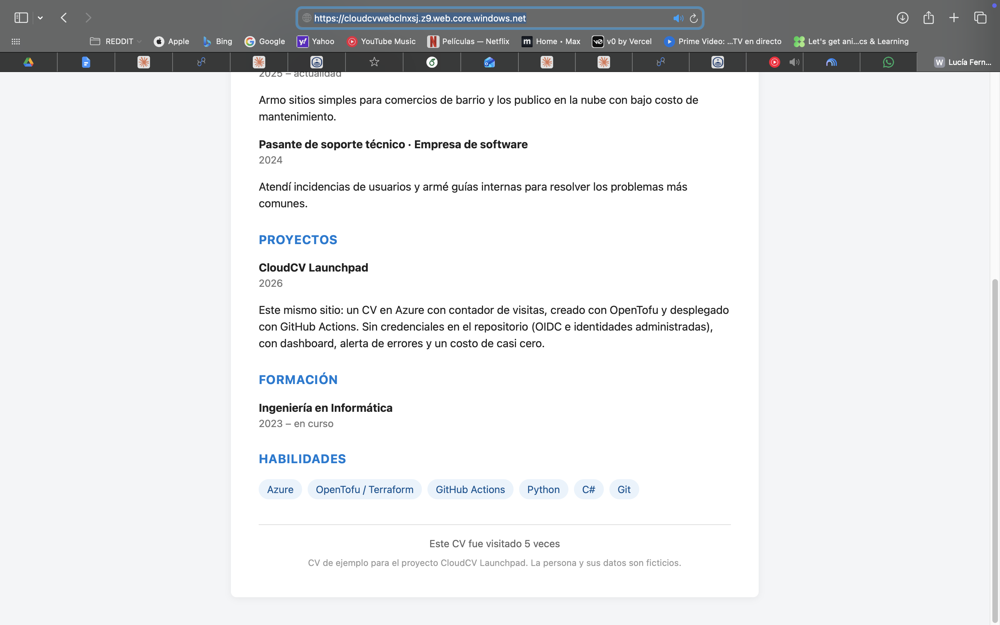
 
Los recursos creados en `rg-cloudcv-dev`:
 
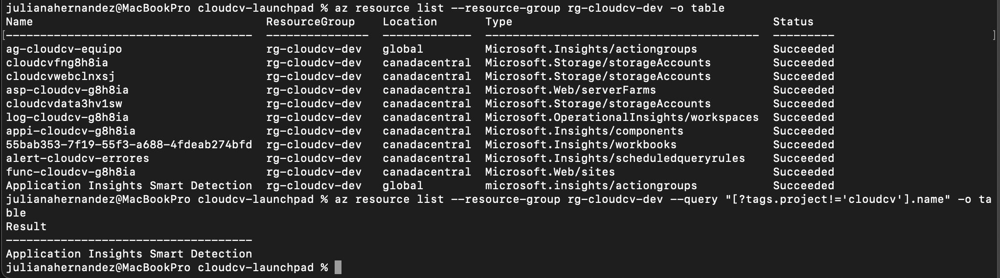
 
#### El pipeline
 
El plan de OpenTofu aparece como comentario en el Pull Request:
 
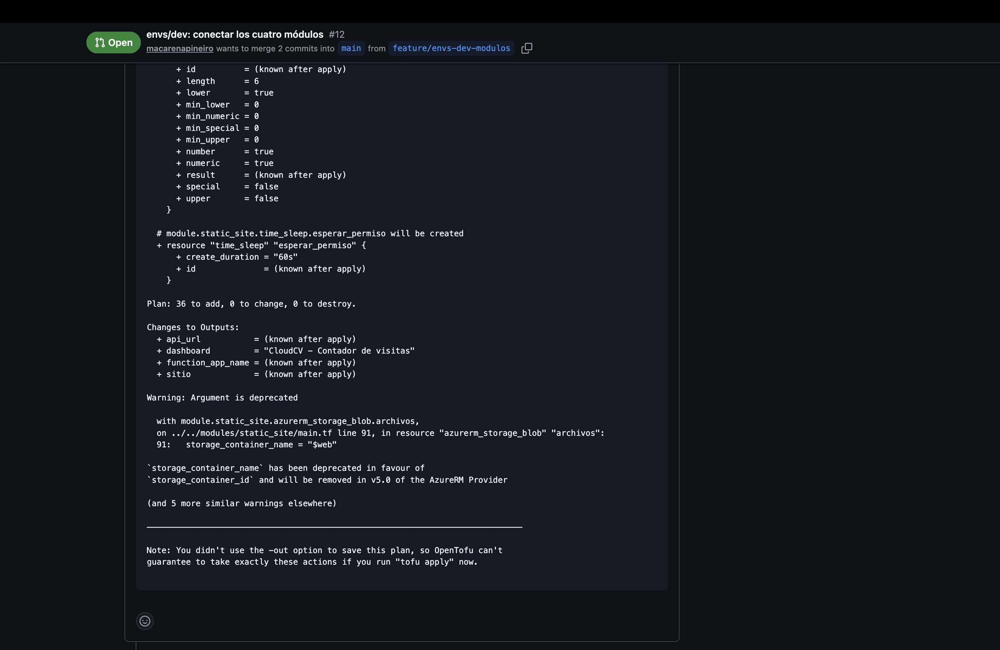
 
El deploy, aprobado y en verde:
 
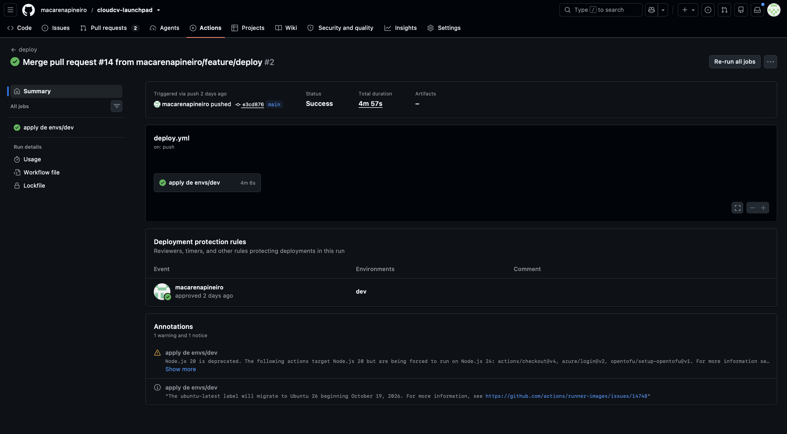
 
El environment `dev` pide la aprobación de una de las dos y solo acepta despliegues desde `main`:
 
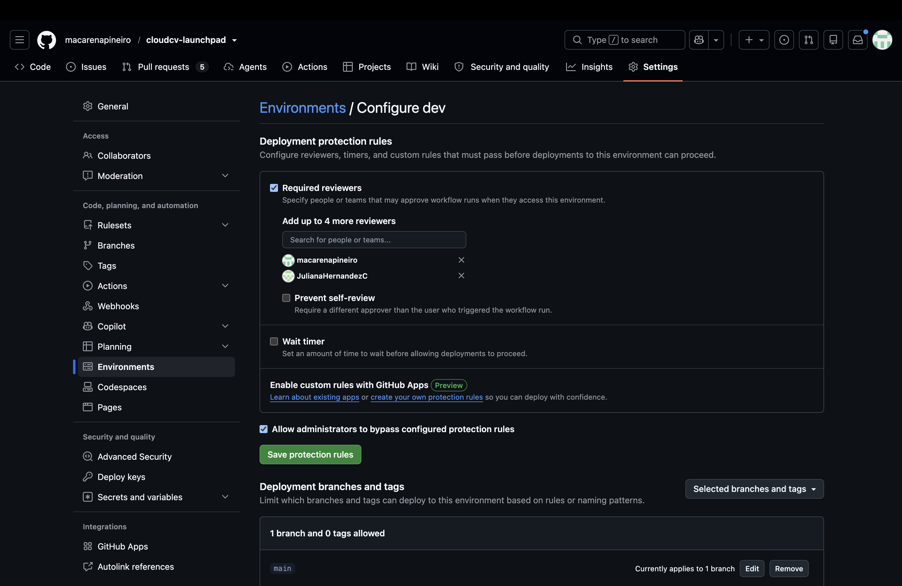
 
Los workflows de colaboradores externos necesitan aprobación (el repo es público):
 
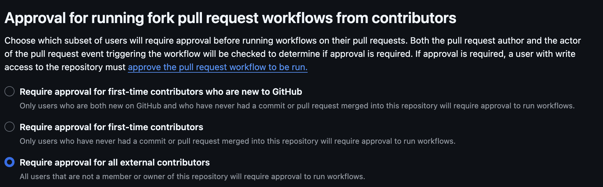
 
Checkov revisa la infraestructura y no encuentra fallos:
 
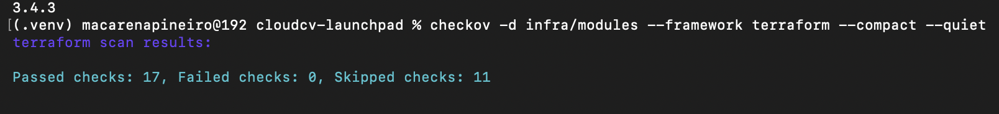
 
#### Seguridad
 
La cuenta de Storage no permite entrar con claves:
 
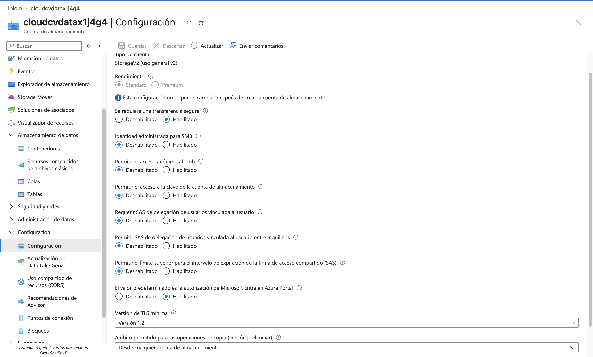
 
La Function solo tiene permiso sobre la tabla del contador:
 
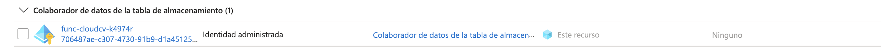
 
CORS: solo el sitio del CV puede llamar a la Function desde el navegador:
 
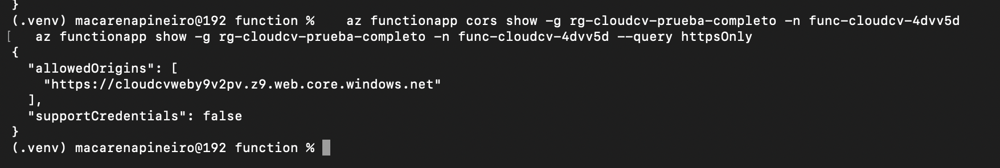
 
Si se llama por HTTP, redirige a HTTPS:
 
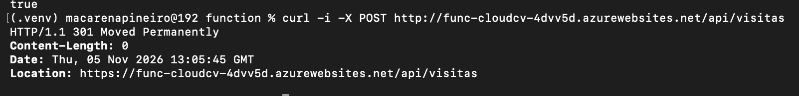
 
#### Observabilidad: prueba de la alerta
 
El dashboard con las visitas, los errores y la latencia:
 
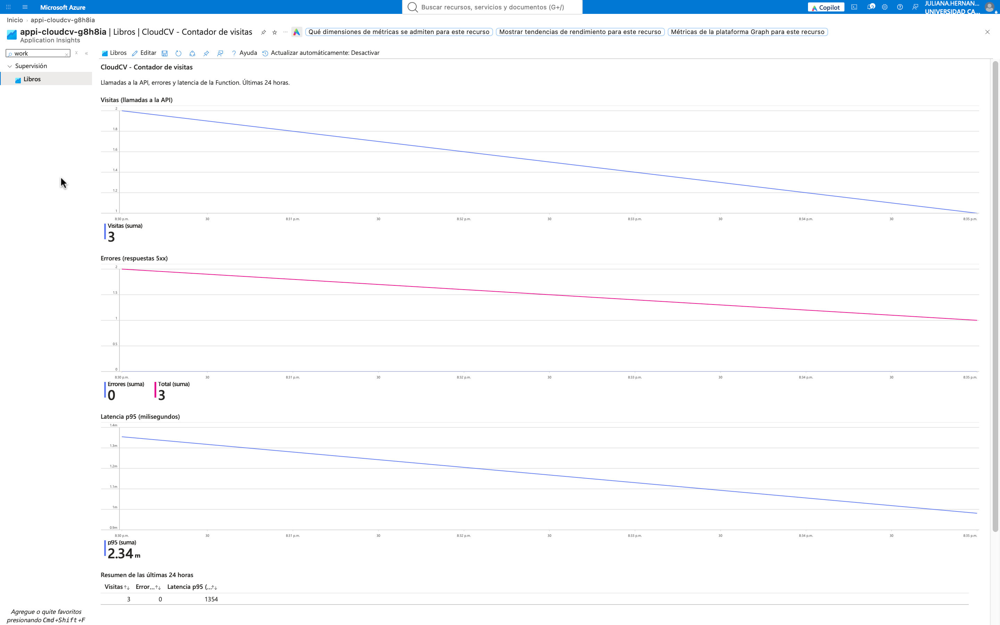
 
Rompimos la Function a propósito y empezó a responder con error 500:
 
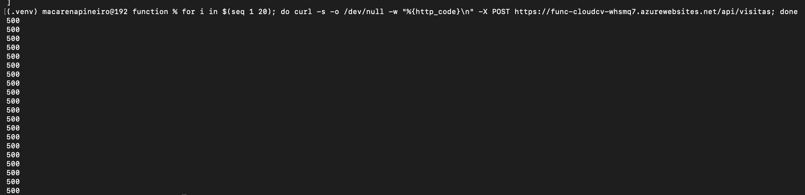
 
El pico de errores en el dashboard:
 
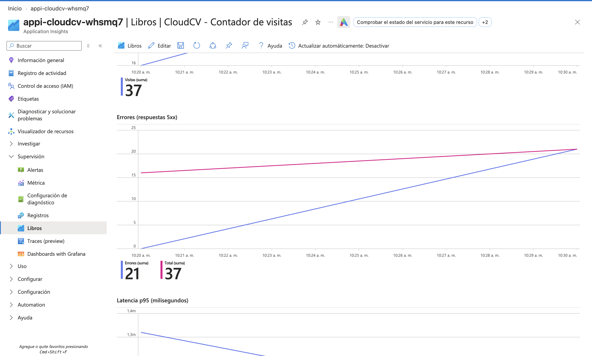
 
La alerta se disparó:
 
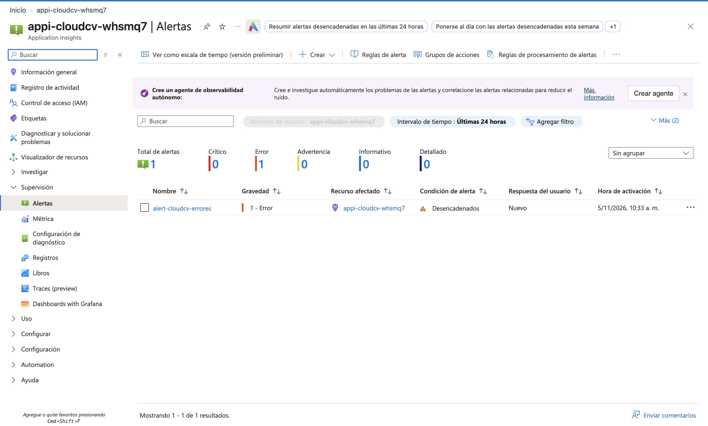
 
`tofu apply` detectó el cambio hecho a mano y lo corrigió:
 
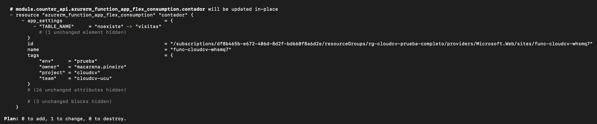
 
La alerta se resolvió sola:
 
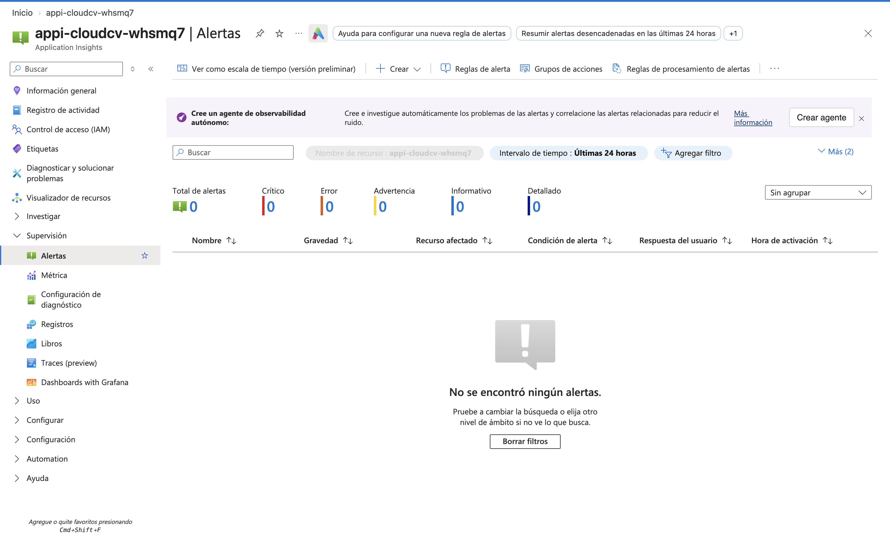
 
#### Costos
 
Lo que costó el proyecto en noviembre (USD 0,13):
 
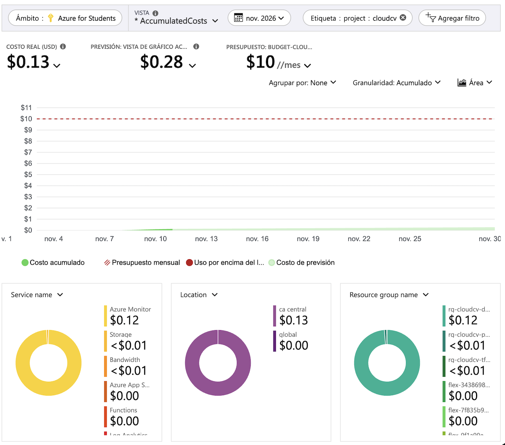
 
El presupuesto de USD 10:
 
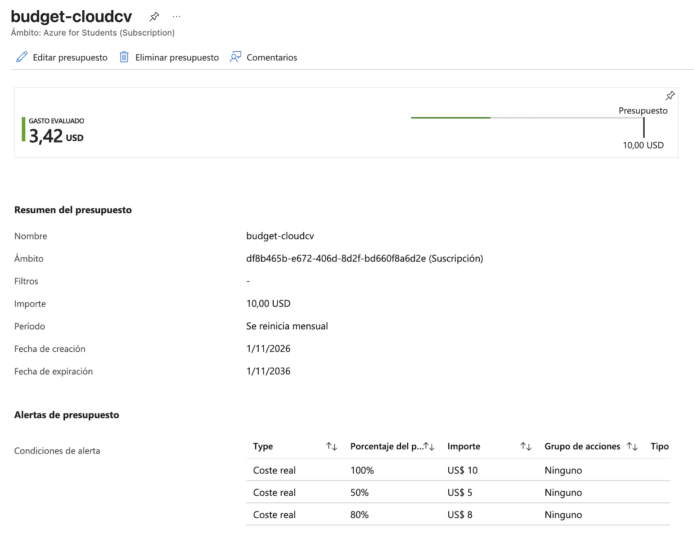
 
La estimación en la calculadora de Azure, con un millón de visitas por mes:
 
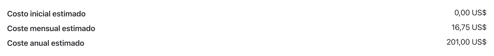
 
Después de probar, destruimos todo:
 
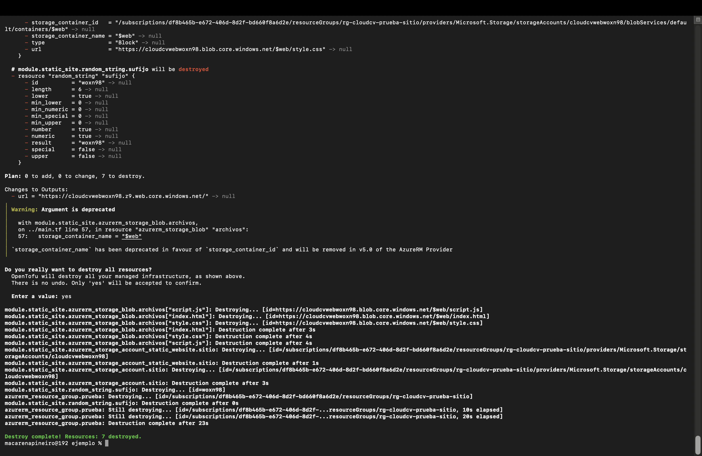
 