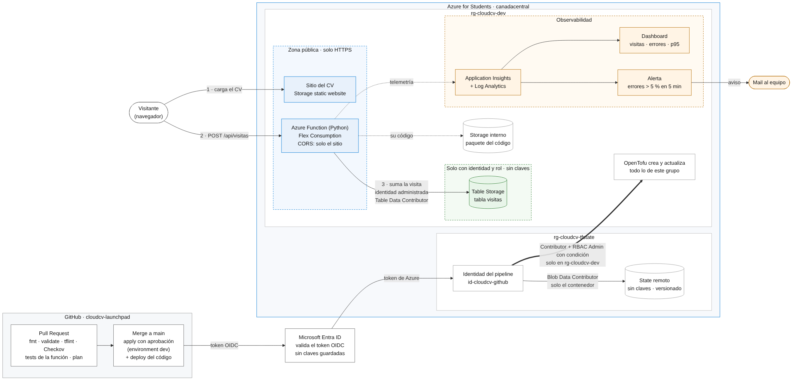

# Un CV en la nube que cuesta casi cero y no tiene contraseñas en el repositorio

*Macarena Piñeiro y Juliana Hernández · Cloud Computing, UCU · noviembre de 2026*

Para el proyecto final de Cloud Computing elegimos CloudCV Launchpad: publicar un CV como página web, con un contador que muestra cuántas veces se visitó. Suena simple, y la aplicación en sí lo es. Lo interesante estuvo en todo lo de alrededor: que se cree solo con código, que no haya contraseñas en el repositorio, que avise si algo se rompe y que cueste lo menos posible.

En este post contamos cómo lo armamos, qué decidimos y en qué nos trabamos.

## Cómo está armado

Hay dos caminos en el diagrama. Arriba está lo que pasa cuando alguien entra al CV. Abajo, lo que pasa cuando cambiamos el código.

Cuando alguien entra:

1. El navegador carga la página desde una cuenta de Storage de Azure, que la publica como sitio web con HTTPS.
2. El JavaScript de la página llama a una Azure Function con un `POST /api/visitas`.
3. La Function suma 1 en una tabla y devuelve el número, que se muestra al pie del CV.

Todo está en Azure, en la región `canadacentral`, y todo se crea con OpenTofu. No hicimos nada a mano en el portal.

## El sitio: más simple de lo que pensábamos

Nuestra primera idea era usar Static Web Apps, que trae CDN y HTTPS incluidos. Pero la suscripción de estudiantes solo nos deja crear recursos en cinco regiones, y Static Web Apps no está disponible en ninguna de ellas. Lo probamos y Azure lo rechazó por la política de la suscripción.

La alternativa fue el *static website* de una cuenta de Storage: subimos el HTML, el CSS y el JS a un contenedor especial (`$web`) y Azure lo publica en una dirección con HTTPS. Para un CV alcanza de sobra y cuesta centavos.

No pusimos CDN porque la de Azure (Front Door) cuesta unos USD 35 por mes, y nuestro presupuesto era de USD 10.

Un detalle que nos gustó: la página necesita saber la dirección de la Function, y esa dirección cambia cada vez que se crea el entorno. En vez de escribirla a mano, OpenTofu genera un archivito `config.js` con la dirección correcta y lo sube junto con el sitio.

## El contador: una tabla sin llave

El contador es una Function en Python, en el plan Flex Consumption. Ese plan escala a cero: si nadie visita el CV, no hay nada encendido y casi no se paga. La contracara es que la primera visita después de un rato tarda alrededor de un segundo, porque la Function tiene que "despertarse". Lo vimos en el dashboard: la latencia más alta siempre era la primera.

El número se guarda en Table Storage. Es una sola fila con un solo número, así que no tenía sentido una base de datos más grande.

Lo que más trabajo nos dio fue la seguridad de la tabla. Una cuenta de Storage normalmente tiene dos claves que dan acceso a todo, como una llave maestra. Nosotras las apagamos: la única forma de entrar es con una identidad de Azure que tenga el permiso justo. La Function tiene su propia identidad (una *identidad administrada*) y el rol *Storage Table Data Contributor*, que le deja leer y escribir filas **solo en la tabla `visitas`**. Si alguien encontrara la dirección de la tabla, no tendría con qué entrar. Lo mismo hicimos con la cuenta del sitio: los archivos se suben con la identidad de quien corre OpenTofu, no con una clave. La única cuenta que todavía tiene clave es la interna de la Function, donde se guarda su código, por un error conocido del provider de Azure.

Apagar las claves nos trajo un problema que no esperábamos. El recurso de OpenTofu que crea tablas (`azurerm_storage_table`), después de crearla, intenta configurarla usando justamente esas claves, y Azure lo rechazaba con un error 403. La solución fue crear la tabla con `azapi`, otro provider de Microsoft que habla directo con la API de Azure y no usa claves.

Otro detalle del código: si dos personas entran al mismo tiempo, las dos podrían leer "41" y guardar "42", y se perdería una visita. Para evitarlo, al guardar le decimos a la tabla "guardá solo si nadie cambió el número desde que lo leí" (usando el *etag* de la fila). Si alguien lo cambió, volvemos a leer y probamos de nuevo. Eso está cubierto en los tests de la función.

## Quién puede llamar a la Function

La Function tiene que ser pública, porque la llama el navegador de cualquier visitante. Pero le pusimos reglas:

- **Solo HTTPS.** Si alguien la llama por HTTP, responde con una redirección a HTTPS.
- **CORS limitado al sitio.** El navegador solo deja usarla desde la página del CV: si otra página intenta llamarla, el navegador lo bloquea. El CORS no frena a alguien que la llame directo, por ejemplo con `curl`. Pero lo peor que puede hacer es sumar visitas, porque la API no devuelve ningún otro dato.

Con el CORS también tuvimos un problema. La primera vez que creábamos todo desde cero, el provider de Azure fallaba con un error que él mismo describía como un bug: en el momento del plan todavía no sabía la dirección del sitio y se confundía. Lo resolvimos sacando el CORS de la Function y configurándolo en un paso aparte, también con `azapi`. Desde ese cambio, un solo `tofu apply` crea todo.

## Saber si algo se rompe

La Function manda datos a Application Insights cada vez que la llaman: cuánto tardó y si salió bien. Con eso armamos dos cosas:

- **Un dashboard** con las visitas, los errores y la latencia p95 (el 95 % de las visitas tardó menos que ese valor). Usamos el p95 y no el promedio porque una visita muy lenta casi no mueve el promedio, pero en el p95 se nota.
- **Una alerta** que cada 5 minutos revisa si más del 5 % de las llamadas fallaron, y si es así nos manda un mail.

Para probar la alerta, rompimos la Function a propósito: le cambiamos a mano el nombre de la tabla por uno que no existe. Empezó a responder con error 500, el dashboard mostró el pico y a los pocos minutos la alerta se disparó. Después corrimos `tofu apply`, que detectó el cambio hecho a mano y volvió a dejar el nombre correcto, y la alerta se cerró sola.

Esa prueba nos mostró algo más: el código es la fuente de verdad. Si alguien toca algo en el portal, el próximo `apply` lo deja como dice el código.

## El pipeline: de un Pull Request a Azure sin contraseñas
Queríamos que nadie desplegara a mano y que no hubiera ninguna clave guardada en el repositorio, que además es público. Todo pasa por GitHub Actions.

**Qué corre en cada Pull Request.** Apenas abrimos un PR, un primer workflow revisa el formato y la validez del código (`fmt` y `validate`), pasa un linter (`tflint`), un escáner de seguridad (Checkov) y los tests de la Function. Checkov nos marcó seis puntos que decidimos aceptar, cada uno con un comentario en el código que explica por qué. Un segundo workflow corre `tofu plan` y deja el resultado como comentario en el PR, así la otra persona ve qué va a cambiar antes de aprobar.

**El deploy con aprobación.** Cuando el PR se une a `main`, arranca el deploy, pero se frena en el environment `dev` hasta que alguien lo aprueba a mano. Después crea los recursos y sube el código de la Function en el mismo workflow. El primer despliegue creó 36 recursos en unos 4 minutos. Para destruir hay otro workflow manual, y para que no se dispare sin querer hay que escribir la palabra `destruir`. Nos tropezamos con una cosa tonta: un paso del deploy tenía mal la sangría del YAML (12 espacios en vez de 6), el archivo no era válido y el primer intento falló. Lo encontramos revisando el YAML antes de reintentar.

**Cómo entra a Azure sin claves.** GitHub Actions le pide a GitHub un token temporal (OIDC) y Azure lo acepta porque configuramos que confíe en nuestro repositorio, en tres casos concretos: un Pull Request, la rama `main` y el environment `dev`. No hay contraseña que robar ni que rotar: el token dura minutos. Nuestro primer intento falló porque Azure compara un texto que identifica al repositorio y el nuestro no coincidía. Lo arreglamos usando los números de identificación del dueño y del repo en vez de los nombres.

**El estado remoto.** OpenTofu guarda lo que creó en un archivo de estado, dentro de un contenedor de Storage aparte, y se accede con permisos de Azure, sin claves de acceso. Ese Storage y la identidad del pipeline se crean una sola vez a mano (el bootstrap) y no se destruyen con el resto.

**Qué puede hacer la identidad del pipeline.** Tiene Contributor solo sobre el grupo `rg-cloudcv-dev`, no sobre toda la suscripción. Además puede asignar permisos, pero con una condición: solo dos roles (Table Data Contributor y Blob Data Contributor). Así, aunque alguien se quedara con el acceso del pipeline, no podría darse permisos de administrador. El detalle está en `docs/iam.md`.

**Lo que cuidamos por ser un repo público.** Los mails de las alertas están en un secreto de GitHub y se tapan con `***@***` en los logs. El environment `dev` solo acepta la rama `main`.

**Lo que dejamos pendiente, a propósito.** Usamos una sola identidad para el plan y para el apply. Lo ideal sería una de solo lectura para los Pull Request. Está anotado como limitación conocida.
## Cuánto cuesta

Durante las pruebas, cada vez que levantamos todo lo tuvimos menos de una hora, y el costo estimado fue de menos de USD 0,05 por prueba. Casi todo entra en lo que Azure regala por mes.

Hicimos también una proyección: con un millón de visitas por mes, el proyecto costaría entre USD 15 y 54, según la memoria de la Function. Por eso la bajamos de 2 GB a 512 MB, que para un contador alcanza de sobra. Todos los números y las medidas de ahorro están en el [informe FinOps](finops.md).

## Qué aprendimos

- **Seguro y barato no se contradicen.** Sacar las claves no cuesta nada, y las medidas que más ahorran (escalar a cero, no usar servicios que cobran por hora) también achican lo que puede salir mal.
- **Los providers tienen bugs.** Dos de nuestros problemas más largos fueron del provider de Azure, no de nuestro código. Leer bien el mensaje de error y buscar el issue en GitHub nos ahorró horas.
- **Probar destruyendo.** Crear todo, probarlo y destruirlo varias veces nos mostró problemas que no hubiéramos visto creando una sola vez, como el del CORS o un recurso que Azure crea solo y frenaba el destroy.
