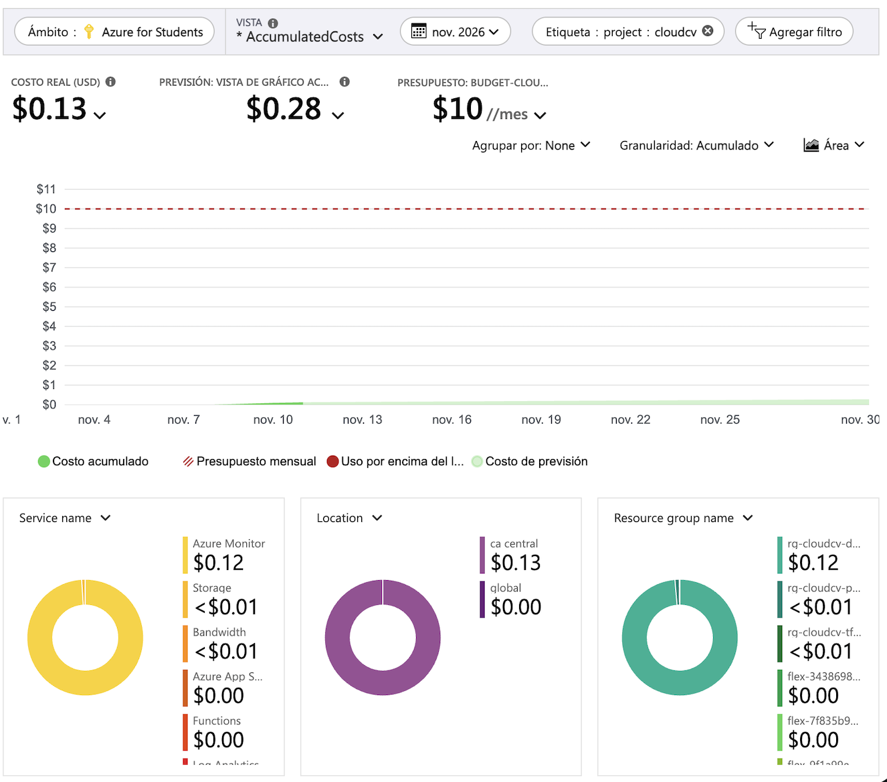
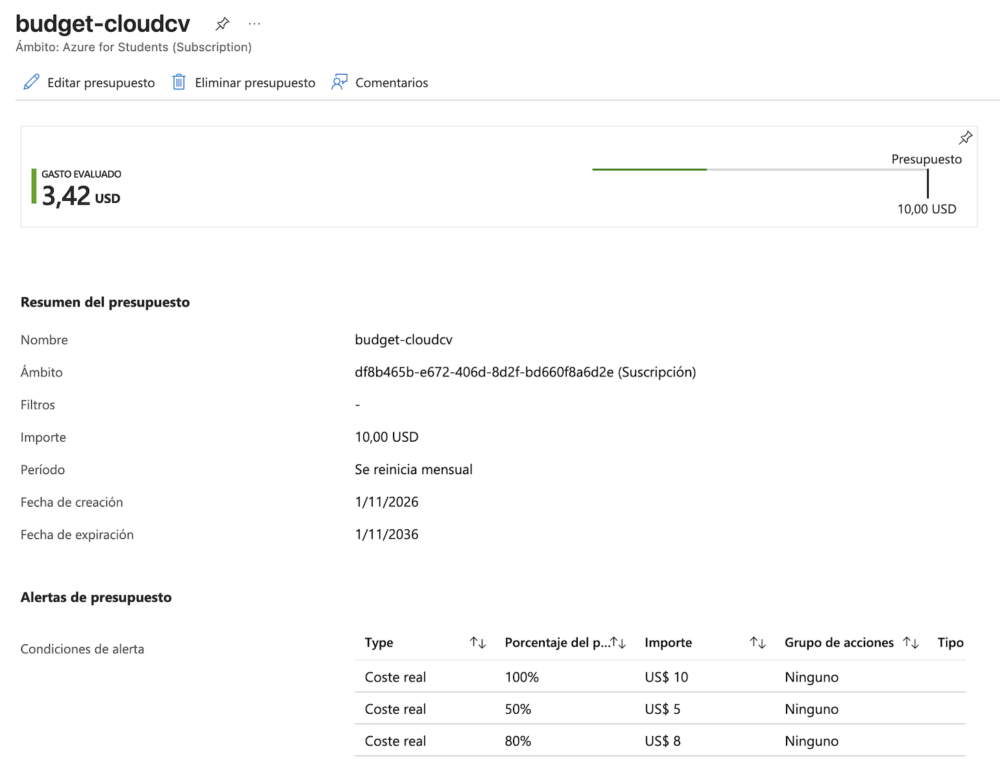
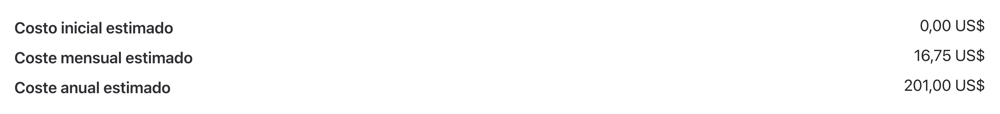

# Informe FinOps

En este informe contamos cuánto nos costó el proyecto mientras lo probábamos, cuánto costaría si el CV tuviera muchas visitas y qué hicimos para gastar lo menos posible.

Los precios que usamos son de referencia, en dólares y con pago por uso. Los sacamos de la página de precios de Azure y de guías de 2025, así que pueden haber cambiado un poco.

## Qué nos cobra Azure

Casi todo lo que usamos cobra solo cuando se usa, y además Azure regala una parte por mes:

| Servicio | Cómo cobra | Lo que regala por mes |
| --- | --- | --- |
| Azure Functions (Flex Consumption) | ~USD 0,000026 por GB-s y ~USD 0,40 por millón de llamadas | 100.000 GB-s y 250.000 llamadas |
| Storage (sitio, datos y paquete de la Function) | Por lo que se guarda y por las operaciones. Con LRS son centavos | — |
| Log Analytics y Application Insights | Por los logs que se guardan, ~USD 2,30 por GB | Los primeros 5 GB |
| Alerta de errores | Un precio fijo de ~USD 1,65 por mes (USD 1,50 por la regla y USD 0,15 por la serie que mira) | — |
| Mails de aviso | Gratis | Hasta 1.000 mails |

La Function cobra por "memoria × tiempo", que se mide en GB-s. Por ejemplo, si una visita usa una instancia de 2 GB durante 1 segundo, son 2 GB-s. Azure cobra como mínimo 1 segundo por cada llamada, aunque dure menos.

## Cuánto nos costaron las pruebas

### Lo que estimamos

Cada vez que levantamos el entorno para probar lo tuvimos menos de una hora y con menos de 100 visitas. Con eso, la Function y los logs entran en lo que regala Azure. Lo único que cobra aunque no se use es la alerta, que sale unos USD 0,002 por hora.

| Recurso | Costo estimado por prueba |
| --- | --- |
| Function | USD 0, porque entra en lo gratis |
| Las tres cuentas de Storage | Menos de USD 0,01 |
| Logs | USD 0, porque entra en lo gratis |
| Alerta de errores | Unos USD 0,002 |
| **Total** | **Menos de USD 0,05** |

### Lo que nos costó en realidad

Lo medimos el 11/11 en **Cost Management → Análisis de costos**, filtrando por la etiqueta `project = cloudcv`. Como todos nuestros recursos tienen esa etiqueta, el filtro muestra solo lo que gastó este proyecto.

| Qué | Costo real (del 1 al 11 de noviembre) |
| --- | --- |
| Alerta de errores (Azure Monitor) | USD 0,12 |
| Storage y tráfico | Menos de USD 0,01 |
| Function, Log Analytics y plan de la Function | USD 0 |
| **Total** | **USD 0,13** |

Cómo se compara con lo que estimamos:

- **Las pruebas costaron lo que calculamos.** Cada vez que levantamos el ejemplo completo para probar, los recursos costaron menos de un centavo.
- **Casi todo el gasto es la alerta del entorno `dev`.** Lo dejamos prendido desde el 8/11 para la entrega, y la alerta cobra aunque nadie use el CV: unos USD 0,05 por día (USD 1,65 por mes). En esos días estimábamos unos USD 0,15, y el costo real fue USD 0,12.
- **Si dejamos `dev` prendido hasta la defensa** (25/11), la alerta suma unos USD 0,70 más. Todo lo demás sigue en USD 0 mientras haya pocas visitas.

#### Por qué el presupuesto marca más

El presupuesto de USD 10 mide toda la suscripción, y en noviembre marcaba USD 3,42 (en el análisis de costos, USD 3,46: las dos pantallas se actualizan en momentos distintos). De eso, USD 3,33 es una máquina virtual de otro trabajo de la facultad, que no tiene nada que ver con CloudCV: su disco (USD 2,06) y su IP pública (USD 1,27). Gracias a las etiquetas pudimos separar lo nuestro en un minuto: sin el filtro `project = cloudcv`, hubiéramos pensado que el proyecto costaba 25 veces más.

También aprendimos que un disco y una IP pública cobran aunque la máquina esté apagada.

## Cuánto costaría con muchas visitas

Para la proyección pensamos en el peor caso: que cada visita sea una llamada aparte y que cada una cobre el mínimo de 1 segundo. En la práctica debería salir más barato, porque una misma instancia puede atender varias visitas a la vez.

| Visitas por mes | Function con 2 GB (como estaba al principio) | Function con 512 MB (como está ahora) | Storage, logs y alerta | Total aproximado |
| --- | --- | --- | --- | --- |
| 1.000 | USD 0 | USD 0 | ~USD 1,65 | **~USD 1,65** |
| 100.000 | ~USD 2,60 | USD 0 | ~USD 2 | **Entre USD 2 y 4,60** |
| 1.000.000 | ~USD 49,70 | ~USD 10,70 | ~USD 4 | **Entre USD 15 y 54** |

Por ejemplo, con un millón de visitas y 2 GB: son 2.000.000 GB-s. Le restamos los 100.000 que regala Azure y quedan 1.900.000 × USD 0,000026 = USD 49,40. Además, se pasan 750.000 llamadas de las gratis, que cuestan USD 0,30. En total, USD 49,70.

### Lo que dice la calculadora de Azure

Después confirmamos el caso de un millón de visitas en la [calculadora de Azure](https://azure.com/e/7282ac331fde49f0a44eae2b9b8b5ab5), en Canada Central, con la Function de 512 MB:

| | Nuestra cuenta a mano | Calculadora de Azure |
| --- | --- | --- |
| Llamadas a la Function | USD 0,30 | USD 0,30 |
| Tiempo de ejecución (512 MB) | USD 10,40 | USD 14,80 |
| Alerta de errores | USD 1,50 | USD 1,65 |
| **Total por mes** | **~USD 12,20** | **USD 16,75** |

Las llamadas dieron exacto. La diferencia está en el tiempo de ejecución: nosotras usamos el precio de referencia de las guías (USD 0,000026 por GB-s), y la calculadora usa el precio real de Canada Central, que es más alto. En la alerta no habíamos contado los USD 0,15 de la serie que mira. Por eso, los números de la tabla de arriba hay que leerlos como un mínimo: en Canada Central, el tiempo de ejecución sale alrededor de un 40 % más caro. La conclusión no cambia: con 512 MB, la Function cuesta la cuarta parte que con 2 GB.

Las capturas de cada producto están en `evidencias/08-calculadora-function.png` y `evidencias/09-calculadora-alerta.png`.

Además, según [Microsoft](https://learn.microsoft.com/azure/azure-functions/functions-consumption-costs), en Flex Consumption se cobra el tiempo que cada instancia está prendida, no cada visita por separado: si una instancia atiende varias visitas a la vez, se paga una sola vez. Por eso nuestra proyección es el peor caso, y en la práctica debería salir más barato.

Con tantas visitas también habría que subir el tope diario de logs, que hoy es de 0,1 GB, o guardar solo una parte de los registros. Si no, Azure deja de guardar logs a mitad del día.

## Qué hicimos para ahorrar

- **Elegimos servicios que no cobran si nadie los usa.** La Function y el Storage escalan a cero: si nadie entra al CV, casi no pagamos nada.
- **No usamos servicios que cobran por hora.** No pusimos CDN (Front Door costaría unos USD 35 por mes), ni redes privadas, ni bases de datos con costo fijo.
- **Usamos Table Storage y no Cosmos DB,** porque el contador es un solo número.
- **Elegimos Storage LRS,** la replicación más barata. La GRS cuesta el doble y para este proyecto no hace falta.
- **Trabajamos en una sola región,** `canadacentral`, que además es más barata que Brasil.
- **Le pusimos un tope a la Function:** como máximo 40 instancias a la vez, para que un pico de visitas no se convierta en un pico de gasto.
- **Bajamos la memoria de la Function de 2 GB a 512 MB.** Para un contador no hacen falta 2 GB, y como Azure cobra por memoria × tiempo, cada visita cuesta la cuarta parte. Con un millón de visitas por mes, el costo de la Function baja de unos USD 50 a unos USD 11.
- **Le pusimos un tope a los logs:** 0,1 GB por día. Los datos de la Function (pedidos, errores, trazas) se guardan 7 días, como pide el enunciado. El workspace en sí no acepta menos de 30, así que la retención de 7 días se pone en cada tabla. Ojo: según Microsoft, bajar de 31 días no ahorra plata, porque esos días ya vienen incluidos en el precio. Lo hacemos para cumplir el enunciado y no guardar datos más de lo necesario.
- **Etiquetamos todos los recursos** con `project`, `team`, `env` y `owner`, para poder ver cuánto gasta el proyecto.
- **Creamos una alerta de presupuesto** de USD 10 sobre toda la suscripción, con avisos al 50, 80 y 100 %. Está en el bootstrap, así que no se borra cuando destruimos el entorno.
- **Destruimos todo al terminar cada prueba.** Lo confirma el costo real: los recursos de las pruebas costaron menos de un centavo cada vez. El destroy no toca el bootstrap (`rg-cloudcv-tfstate`): el state y la identidad del pipeline quedan, porque hacen falta para volver a crear el entorno. Cuestan centavos por mes.

### Lo que podríamos mejorar

- **Apagar la clave de la cuenta interna de la Function.** Es la única cuenta que todavía la tiene, por un error conocido del provider. Cuando lo corrijan, se puede apagar como en las otras.

- **Que la alerta revise cada 15 minutos en vez de cada 5.** Saldría más barata, aunque nos enteraríamos de los errores un poco más tarde.

### Sobre los datos de prueba

El enunciado pide que los datos de prueba se borren solos después de un tiempo. En nuestro caso no se acumulan, porque la tabla tiene una sola fila con el contador. Además, cada vez que destruimos el entorno se borra la tabla entera.

## Fuentes

- [Precios de Azure Functions](https://azure.microsoft.com/pricing/details/functions/)
- [Plan Flex Consumption: cómo se factura](https://learn.microsoft.com/azure/azure-functions/flex-consumption-plan)
- [Guía de precios de Azure Functions (Pump, febrero de 2025)](https://www.pump.co/blog/azure-functions-pricing/)
- [Guía de precios de Azure Functions (Modal, mayo de 2025)](https://modal.com/blog/azure-function-pricing-guide)
- [Cómo estimar los costos del plan Flex Consumption](https://learn.microsoft.com/azure/azure-functions/functions-consumption-costs)
- [Calculadora de Azure: nuestra estimación](https://azure.com/e/7282ac331fde49f0a44eae2b9b8b5ab5)
- [Microsoft Q&A: costos de Log Analytics y de las alertas](https://learn.microsoft.com/en-us/answers/questions/5645391/cost-effective-way-to-monitor-telemetry-data)
- [Precios de Azure Monitor](https://azure.microsoft.com/pricing/details/monitor/)
